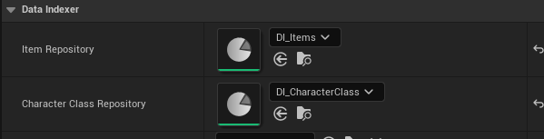

# Repository Metadata

DataIndexer exposes several metadata keys that control how repository properties behave in the editor. This page covers the two most commonly used: **schema filtering** on UPROPERTY pickers, and **NotOverridable** field locking in parent-child hierarchies.

## Schema Filtering { #schema-filtering }

When a class exposes a `UDataIndexerRepository` UPROPERTY, by default the asset picker shows every repository in the project regardless of schema. Add `meta = (Schema = "...")` to restrict it to only repositories that use a specific schema.

This prevents accidental assignment of a quest repository to an item slot, or a character repository to a shop.

### C++

```cpp
UPROPERTY(EditDefaultsOnly, BlueprintReadOnly, Category = "DataIndexer",
    meta = (Schema = "/Game/DataIndexer/BP_ItemSchema.BP_ItemSchema"))
TObjectPtr<UDataIndexerRepository> ItemRepository;

UPROPERTY(EditDefaultsOnly, BlueprintReadOnly, Category = "DataIndexer",
    meta = (Schema = "/Game/DataIndexer/BP_QuestSchema.BP_QuestSchema"))
TObjectPtr<UDataIndexerRepository> QuestRepository;
```

The meta value is the asset path of the **Schema Blueprint** (not the repository). Use the same format returned by right-clicking the asset and selecting **Copy Reference**.

!!! note "Relative paths"
    The path must be an absolute content path starting with `/Game/`. Plugin content uses `/PluginName/`.

### Blueprint

1. Open the Blueprint that owns the variable
2. Select the `UDataIndexerRepository` variable in the **My Blueprint** panel
3. In the **Details** panel, find the **Schema** picker under **Variable**
4. Select your schema asset — the picker is now filtered to matching repositories

Clear the picker to restore the unfiltered view.

### GameMode example

A typical setup with multiple data domains on a single GameMode:

```cpp
UCLASS()
class AMyGameMode : public AGameModeBase
{
    GENERATED_BODY()

public:
    UPROPERTY(EditDefaultsOnly, Category = "Data",
        meta = (Schema = "/Game/DataIndexer/BP_ItemSchema.BP_ItemSchema"))
    TObjectPtr<UDataIndexerRepository> ItemRepository;

    UPROPERTY(EditDefaultsOnly, Category = "Data",
        meta = (Schema = "/Game/DataIndexer/BP_CharacterSchema.BP_CharacterSchema"))
    TObjectPtr<UDataIndexerRepository> CharacterRepository;

    UPROPERTY(EditDefaultsOnly, Category = "Data",
        meta = (Schema = "/Game/DataIndexer/BP_QuestSchema.BP_QuestSchema"))
    TObjectPtr<UDataIndexerRepository> QuestRepository;
};
```

Each UPROPERTY's picker only shows repositories of the matching schema. Designers cannot assign the wrong type.

The bundled `CharacterSchema` uses the same technique: its `Item Repository` (filtered to `ItemSchema`) and `Character Class Repository` (filtered to `CharacterClassSchema`) pickers each list only repositories of their declared schema.



---

## NotOverridable { #notoverridable }

When a child repository overrides a parent row, *all* fields are editable by default in the child's Data View. Add the `NotOverridable` metadata to a struct field to lock it — the field becomes read-only whenever a child edits a parent row.

This is useful for base stats that the content team should never change per-region or per-shop: base cost, attack power, rarity tier.

### Blueprint (User Defined Struct)

1. Open the schema Blueprint that uses your row struct
2. In **Class Defaults**, find the field in the **Column Layout** category
3. Click the lock icon to the right of the eye icon to lock the field

The field is now read-only in any child repository that overrides this row, and always follows the value from the nearest parent repository. The value is not stored in the child repository's asset.

### C++ (native structs)

For native structs, add `meta = (NotOverridable)` to the UPROPERTY. The Column Layout lock icon only appears for User Defined Struct fields.

```cpp
USTRUCT(BlueprintType)
struct FItemRow
{
    GENERATED_BODY()

    UPROPERTY(EditAnywhere, BlueprintReadWrite, meta = (NotOverridable))
    int32 BaseValue = 0;

    UPROPERTY(EditAnywhere, BlueprintReadWrite, meta = (NotOverridable))
    EItemRarity Rarity;
};
```

### Checking the flag in a property customization

If you write a custom `IPropertyTypeCustomization`, you can read the flag to enforce read-only rendering:

```cpp
void FMyRowCustomization::CustomizeChildren(
    TSharedRef<IPropertyHandle> StructHandle,
    IDetailChildrenBuilder& Builder,
    IPropertyTypeCustomizationUtils& Utils)
{
    uint32 NumChildren = 0;
    StructHandle->GetNumChildren(NumChildren);

    for (uint32 i = 0; i < NumChildren; ++i)
    {
        TSharedPtr<IPropertyHandle> Child = StructHandle->GetChildHandle(i);
        IDetailPropertyRow& Row = Builder.AddProperty(Child.ToSharedRef());
        if (Child->GetProperty()->HasMetaData(TEXT("NotOverridable")))
        {
            Row.IsEnabled(false);
        }
    }
}
```

### Example: item repository with locked base stats

Scenario: a global item repository defines `BaseValue` and `Rarity`. Regional shop repositories may override items (e.g. to change a discount flag) but must never alter the base stats.

1. Mark `BaseValue` and `Rarity` in `FItemRow` as NotOverridable (see the Blueprint or C++ steps above)
2. Create `DI_AllItems` as the global repository
3. Create `DI_ShopA` with `DI_AllItems` as a parent (see [Parent Repository Hierarchy](parent-hierarchy.md))
4. In `DI_ShopA`, open any parent-sourced row — `BaseValue` and `Rarity` are greyed out

See [Parent Repository Hierarchy](parent-hierarchy.md) for the full hierarchy setup.
